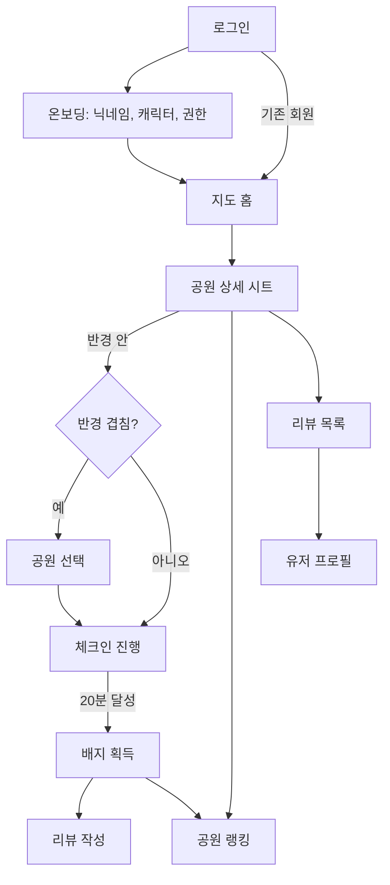
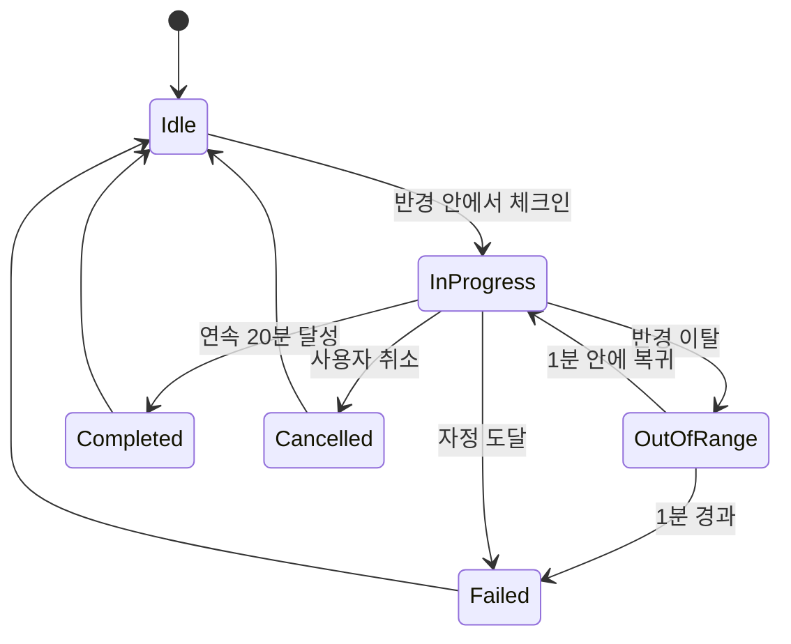

# 프론트엔드 (iOS) 설계

> 구현 기준 문서. 범위·완료 조건은 `frontend-mvp.md`, API는 `api-spec.md`, 화면은 `screens/`, 디자인 값은 `design/`를 본다.

## 1. 기술 스택

| 구분 | 선택 | 비고 |
|---|---|---|
| 언어 / UI | Swift + SwiftUI | 백그라운드 위치 안정성 때문에 네이티브 |
| 최소 버전 | iOS 17 | `@Observable`, `CLBackgroundActivitySession` |
| 아키텍처 | MVVM + Repository | View → ViewModel → Repository → APIClient |
| 지도 | 네이버 지도 iOS SDK (NMapsMap) | SwiftUI에서는 `UIViewRepresentable`로 래핑 |
| 위치 | CoreLocation | 체크인 중에만 위치 업데이트 |
| 네트워크 | URLSession + async/await | 외부 라이브러리 없이 APIClient 직접 구현 |
| 토큰 저장 | Keychain | Access / Refresh |
| 로그인 | Apple, 카카오, 구글, 이메일 | 소셜 토큰을 서버로 전달 → 서버 JWT 수신 |
| 알림 | UserNotifications | 1차는 로컬 알림만 |

## 2. 화면 구성

### 탭
**지도(홈) / 도감 / 마이**

### 화면 목록 (괄호 안은 `screens/`의 화면 ID)

| 화면 | 주요 내용 | ID |
|---|---|---|
| 로그인 | Apple · 카카오 · 구글 · 이메일 | 12e |
| 이메일 가입 / 로그인 | 이메일, 비밀번호 | (디자인 없음) |
| 온보딩 | 닉네임(중복 확인) → 캐릭터 선택 → 위치·알림 권한 안내 | 07b·07c, 12f, 07e |
| 지도 홈 | 내 위치, 반경 1km 공원 마커(3상태), 체크인 중 상단 배너, 공원 없음 | 12a, 03a~03c |
| 공원 상세 시트 | 정보, 체크인 버튼 3상태, 이달의 시상대, 리뷰 요약 | 12b, 04a~04c |
| 공원 선택 시트 | 반경이 겹칠 때 체크인할 공원 선택 | (디자인 없음) |
| 체크인 진행 | 남은 시간 타이머, 반경 이탈 경고, 취소 확인, 실패(이탈·자정) | 12c, 05a~05e |
| 배지 획득 | 배지, 새 업적, 이달 순위(변동·시상대까지 남은 개수), 리뷰·랭킹 이동 | 12d, 06a |
| 공원 랭킹 | 월 선택, 시상대 1~3등, 내 순위 고정, 빈 자리 | 12g, 08a, 08b |
| 리뷰 목록 | 정렬(최신·도움돼요·별점), 도움돼요, 더보기(신고·차단) | 08c, 08d |
| 리뷰 작성 / 수정 | 별점 + 텍스트, 작성 불가 안내 | 08e, 08f, 08g |
| 배지 도감 | 유형별·업적 배지, 미획득은 실루엣 | 12h, 09a |
| 마이페이지 | 캐릭터·통계·내 리뷰·설정(로그아웃·탈퇴·약관) | 12i, 09b, 09c |
| 다른 유저 프로필 | 캐릭터, 총 배지, 시상대에 오른 공원, 신고·차단 | 09d, 09e |
| 공통 상태 | 로딩, 네트워크 에러, 위치 권한 거부 | 10a~10c |

### 화면 흐름

## 3. 체크인 상태 머신

### 위치 권한과 백그라운드 측정
- 권한은 **"앱을 사용하는 동안"만** 요청한다. "항상 허용"은 요청하지 않는다.
- 체크인은 항상 사용자가 앱 화면에서 시작하므로 아래 설정으로 앱을 내려도 측정이 유지된다.
  - `allowsBackgroundLocationUpdates = true`
  - `showsBackgroundLocationIndicator = true`
  - 체크인 시작 시 `CLBackgroundActivitySession` 생성, 종료 시 무효화
- 권한 요청 전에 왜 필요한지 설명하는 화면(07e)을 먼저 보여준다. 거부되면 10c로 안내하고 설정 앱으로 보낸다.

### 측정 규칙
- `desiredAccuracy = kCLLocationAccuracyNearestTenMeters`, `distanceFilter = 10`
- `horizontalAccuracy > 100m`인 샘플은 무시한다(GPS 튐 방지).
- 반경 판정: 공원 중심점과의 거리 ≤ 공원 판정 반경(서버가 면적 기반으로 계산해 내려줌).
- 경과 시간 = 체크인 시작 시각과 현재 시각의 차이(앱 내부 타이머에 의존하지 않는다).
- 이탈 시: 이탈 시각 기록 + 로컬 알림 "1분 안에 공원으로 돌아오세요" → 복귀하면 해제, 1분이 지나면 실패 API 호출.
- 자정(KST)에 도달하면 실패 처리한다. 서버도 동일하게 검증한다.
- 20분 달성 시 완료 API를 호출하고, 성공하면 로컬 알림 + 배지 획득 화면을 보여준다.
- 앱이 **강제 종료**되면 위치 수신이 끊기므로 측정할 수 없다. 재실행 시 `GET /api/check-ins/current`로 진행 중 세션을 조회해 실패 처리하고 안내한다(1차 정책).
- 체크인 상태는 `UserDefaults`에도 저장해 재실행 시 복구한다.
- 이동 경로 좌표는 저장하거나 로그로 남기지 않는다.

## 4. 지도
- 앱 진입 시, 그리고 위치가 **300m 이상** 바뀌면 `GET /api/parks/nearby`로 반경 1km 공원을 다시 조회한다.
- 마커는 서버의 `myStatus`로 3상태를 구분한다: `NONE`(미획득) / `EARNED`(받은 적 있음) / `EARNED_TODAY`(오늘 받음). 색 + 아이콘 + 칩으로 구분한다.
- 체크인 버튼은 현재 위치가 해당 공원 반경 안일 때만 활성화한다.
- 지도 기본 스타일은 SDK 기본이고, 손그림은 마커·내 위치·반경 원에 적용한다(`design/README.md` 참고).

## 5. 서버 연동
- 인증: 소셜 SDK 토큰(Apple identityToken, 카카오 accessToken, 구글 idToken)을 서버로 보내고, 서버 JWT(Access/Refresh)를 받아 Keychain에 저장한다.
- 모든 요청에 `Authorization: Bearer` 헤더.
- 401 → Refresh로 재발급 후 원 요청 1회 재시도, 실패하면 로그인 화면.
- 에러 응답의 `code`로 사용자 메시지를 분기한다. 매핑은 한 곳에서만 관리한다(`api-spec.md`의 에러 코드 표).
- 회원 탈퇴는 앱 안에서 가능해야 한다(App Store 정책). 확인 단계 2번.

## 6. Info.plist / Capabilities
- `NSLocationWhenInUseUsageDescription`: 위치 권한 사용 목적 문구
- Background Modes → **Location updates**
- **Sign in with Apple** capability
- 카카오: URL Scheme, `LSApplicationQueriesSchemes`(kakaokompassauth, kakaolink)
- 구글: Reversed Client ID URL Scheme
- 네이버 지도 Client ID (`Secrets.xcconfig`에서 주입, 커밋 금지)

## 7. 개발 순서
1. 프로젝트 세팅, 탭 구조, 디자인 시스템 토큰·공통 컴포넌트
2. APIClient + Keychain + 토큰 재발급 (Mock Repository 포함)
3. 로그인(Apple·카카오) + 온보딩
4. 지도 래핑 + 내 위치 + 주변 공원 마커
5. 공원 상세 시트
6. **CheckInTracker**(상태 머신, 백그라운드 위치, 로컬 알림) — 실기기 테스트 필요
7. 배지 획득 화면
8. 공원 월간 랭킹
9. 리뷰 목록·작성·수정·삭제·신고·차단
10. 로그아웃·탈퇴·약관, (P1) 구글·이메일 로그인, 업적, 도감·통계
11. 실제 공원 필드 테스트, 배터리 소모 확인, TestFlight
